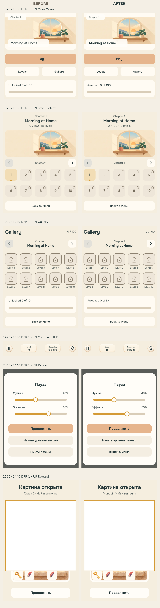

# Desktop text sharpness correction evidence

These captures compare the unchanged Phaser 4.2.1 Text bitmaps through the production transformer (Before) and the scoped native-text transformer (After). They were captured from commit `fbd0a206cbf741b5fd5911618e1d83713c36320b` plus this change in Linux headless Chromium 151 with SwiftShader WebGL. Windows 125% scaling and mobile DPR were emulated; this is not native Windows or physical-device approval.

The comparison covered fresh loads at 1920×1080 DPR 1, 2560×1440 DPR 1, 1366×768 DPR 1, 1536×864 DPR 1.25, and 390×844 at DPR 2 and 3. RU and EN captures covered Main Menu, Level Select, Gallery, compact gameplay HUD, Pause, and Reward.

For every compared Text object, the before/after Canvas bitmap SHA-256 values, logical dimensions, texture count, and texture bytes were identical. Only submitted quad geometry changed in eligible desktop cases. Representative FHD menu Text memory remained 79,540 bytes before and after; FHD Pause remained 96,096 bytes. The laptop, mobile DPR 2, and mobile DPR 3 screenshots were byte-identical before and after:

| Control | Before/after screenshot SHA-256 prefix |
| --- | --- |
| 1366×768, DPR 1 | `19d81d79ecfe` |
| 390×844, DPR 2 | `ec14713c5e87` |
| 390×844, DPR 3 | `68e15b1ab08b` |

Targeted browser checks also covered `setText`, font-size changes, wrapping and padding, centered/right-aligned origins, nested containers, short and long RU/EN labels, pressed state, scene restart, and destruction. Rotation, scale, flip, crop, WebGL filters/masks, active tweens, resize-stretched backing buffers, DPR changes, and Canvas rendering retained Phaser's original geometry.

Three 180-frame diagnostic samples measured median Text transformer cost of approximately 3.24 microseconds per call before and 10.65 microseconds after on the six-label menu, or about 0.045 milliseconds additional work per frame. Frame timing remained refresh-limited in both runs. These SwiftShader measurements are useful for regression detection but are not native-GPU benchmarks. Mobile does not attach the adapter.

